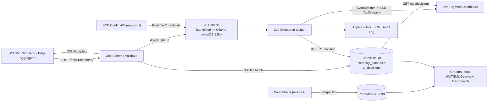

# WITSML Edge Agent

Real-time WITSML drilling telemetry analysis with local LLM inference — Invisible Lost Time (ILT) detection, TimescaleDB hypertable persistence, Prometheus metrics, Grafana observability, live SSE dashboard, and zero cloud inference cost.

## What it is

An Express edge agent that ingests WITSML-style drilling telemetry, validates sensor windows with strict Zod schemas, persists raw telemetry batches and AI assessments into TimescaleDB hypertables, analyzes operations against runtime-configurable Standard Operating Procedures (SOPs) using a locally hosted LLM (`LangChain` + `Ollama` running `qwen2.5:1.5b`), exposes Prometheus metrics via `prom-client`, and streams structured assessments to both a live SSE web dashboard and pre-provisioned Grafana dashboards.

## Why it exists

Invisible Lost Time (ILT) is drilling and connection time lost to operational inefficiency that goes unflagged in the moment. Cloud LLM analysis introduces satellite latency, data egress risks, and recurring token costs; this edge agent runs entirely on local rig or edge server hardware with full time-series persistence and observability.

## Architecture



## Quick Start

### Docker Compose Stack (Recommended)

```bash
git clone https://github.com/kirk-keel/witsml-edge-agent.git
cd witsml-edge-agent
docker build --network=host -t witsml-edge-agent-witsml-agent .
docker compose up -d
```

| Service | Container | Host Port | Description |
| :--- | :--- | :--- | :--- |
| **WITSML Edge Agent** | `witsml-agent` | `3000` | Express API, SSE stream, live SOP dashboard, and `/metrics` |
| **TimescaleDB** | `timescaledb` | `5432` | PostgreSQL 15 + TimescaleDB (`telemetry_batches`, `ai_decisions` hypertables) |
| **Prometheus** | `prometheus` | `9090` | Scrapes `witsml-agent:3000/metrics` every 15s |
| **Grafana** | `grafana` | `3001` | Pre-provisioned `Prometheus` + `TimescaleDB` datasources and WITSML Overview dashboard |

### Local Node Development

```bash
cp .env.example .env
npm install
npm start
```

### Simulate WITSML Telemetry & Run Tests

```bash
# Run automated API & metrics integration tests:
npm test

# Dispatch a single test payload:
node scripts/test-payload.js

# Run the multi-window WITSML stream simulator (single pass or continuous rig loop):
node stream-simulator.js
node stream-simulator.js --continuous
```

## Endpoints

| Method | Path | Description |
| :--- | :--- | :--- |
| `GET` | `/health` | Liveness probe (`200 OK`) |
| `GET` | `/ready` | Deep readiness probe checking live TimescaleDB latency, Ollama (`qwen2.5:1.5b`) reachability, queue depth, edge disk spool, and cloud-sync status |
| `GET` | `/metrics` | Prometheus metrics (`witsml_telemetry_batches_total`, `witsml_telemetry_points_total`, `witsml_ai_inference_duration_seconds`, `witsml_ilt_detections_total`, `witsml_ilt_duration_seconds_total`, `witsml_ilt_cost_usd_total`, `witsml_drilling_rop_fphr`, `witsml_drilling_mse_psi`, `witsml_bit_wear_pct`, `witsml_stick_slip_index`, `witsml_tripping_speed_fpm`, `witsml_well_control_events_total`, `witsml_edge_spool_pending`, `witsml_ai_decisions_total`, `witsml_ai_queue_depth`, `witsml_alert_events_total`) |
| `GET` | `/openapi.json` | Machine-readable OpenAPI 3.1.0 specification |
| `GET` | `/api/docs` | Interactive HTML OpenAPI 3.1 endpoint explorer |
| `POST` | `/api/v1/telemetry` | Schema-validated WITSML JSON window ingestion (`202 Accepted`; supports optional `flow_out_gpm`, `pit_gain_bbl`, `gas_units`, `ecd_ppg`, `torque_klbft`, rate limiting, and `EDGE_API_KEY`) |
| `POST` | `/api/v1/witsml/xml` | Native WITSML v1.4.1.1 / v2.0 `<log>` XML ingestion (`TIME`, `DEPT`, `DBTM`, `BPOS`, `HKLD`, `WOB`, `SPPA`, `MFIA`, `MFOA`, `TVCA`, `GASA`, `ECDA`, `TQA`, `RPM`) |
| `POST` | `/api/witsml` | Legacy alias forwarded to the telemetry ingestion pipeline |
| `GET` | `/api/sops` | Retrieve active SOP thresholds (`?rig_id=Rig-412` for per-rig profile or global default) |
| `GET` | `/api/sops/profiles` | Retrieve default and per-rig SOP profiles stored in memory and TimescaleDB (`rig_sops`) |
| `POST` | `/api/sops` | Update runtime SOP thresholds (`min_wob`, `min_rpm`, `min_flow`, `max_conn_time`, `rig_day_rate_usd`, optional `rig_id`) |
| `GET` | `/api/decisions` | Retrieve recent AI rig state decisions from TimescaleDB (`?limit=25&rig_id=Rig-412&is_ilt=true`) |
| `GET` | `/api/decisions/export` | Download shift ILT / Daily Drilling Report (DDR) in CSV (`?format=csv`) or JSON (`?format=json`) including `ilt_cost_usd`, `rop_fphr`, `mse_psi`, and `hydraulic_status` |
| `GET` | `/api/batches` | Retrieve recent raw WITSML telemetry windows from TimescaleDB (`?limit=10&rig_id=Rig-412`) |
| `GET` | `/api/alerts` | Retrieve recent ILT and Well Control alert events triggered by the alert dispatcher |
| `GET` | `/api/stats` | Aggregated KPI summary (`total_batches`, `total_decisions`, `ilt_count`, `total_ilt_seconds`, `total_ilt_cost_usd`, `avg_rop_fphr`, `avg_mse_psi`, `avg_confidence`, `queue`, `spool`) |
| `GET` | `/api/stats/hourly` | TimescaleDB `time_bucket('1 hour', timestamp)` rollup of ILT events and lost time (`?hours=24`) |
| `GET` | `/api/fleet/leaderboard` | Multi-rig efficiency and well control benchmark leaderboard ranked by ILT rate and ROP |
| `GET` | `/api/cloud-sync/status` | Rig-to-Cloud batch replication status and checkpoint |
| `POST` | `/api/cloud-sync/trigger` | Trigger immediate Rig-to-Cloud batch sync |
| `GET` | `/api/stream` | Server-Sent Events (SSE) stream with 25s keep-alive heartbeats for live dashboard updates |

## Documentation

- [System Architecture](docs/architecture.md)
- [ADR 0001: Edge AI & Time-Series Observability Stack](docs/adr/0001-architecture.md)

## License

MIT — see [LICENSE](LICENSE).
