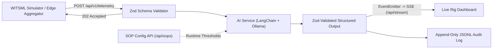

# WITSML Edge Agent

Real-time WITSML drilling telemetry analysis with local LLM inference — Invisible Lost Time (ILT) detection, live SSE dashboard, and zero cloud cost.

## What it is

An Express service that ingests WITSML-style drilling telemetry, validates sensor windows with strict Zod schemas, analyzes operations against runtime-configurable Standard Operating Procedures (SOPs) using a locally hosted LLM (LangChain + Ollama), and streams structured assessments to a live dashboard over Server-Sent Events (SSE). SOP thresholds are configurable at runtime — no redeploy required.

## Why it exists

Invisible Lost Time (ILT) is drilling and connection time lost to operational inefficiency that goes unflagged in the moment. Cloud LLM analysis introduces satellite latency, data egress risks, and token costs; this edge agent runs entirely on local rig/homelab hardware over Tailscale, for free.

## Architecture



## Quick Start

```bash
git clone https://github.com/kirk-keel/witsml-edge-agent.git
cd witsml-edge-agent
cp .env.example .env
npm install
npm start
```

### Simulate WITSML Telemetry

```bash
node scripts/test-payload.js
# or run the multi-window stream simulator:
node stream-simulator.js
```

## Endpoints

| Method | Path | Description |
| :--- | :--- | :--- |
| `POST` | `/api/v1/telemetry` | Schema-validated WITSML window ingestion (`202 Accepted`) |
| `POST` | `/api/witsml` | Legacy alias forwarded to the telemetry ingestion pipeline |
| `GET` | `/api/sops` | Retrieve active SOP thresholds (returns safe in-memory defaults if uninitialized) |
| `POST` | `/api/sops` | Update runtime SOP thresholds (`min_wob`, `min_rpm`, `min_flow`, `max_conn_time`) |
| `GET` | `/api/stream` | Server-Sent Events (SSE) stream for live dashboard updates |

## License

MIT — see [LICENSE](LICENSE).
